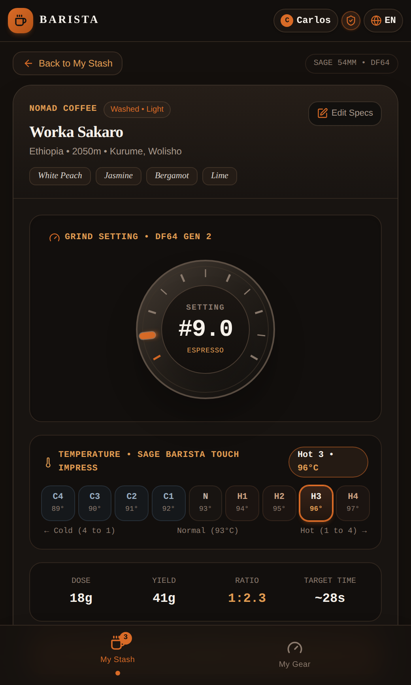
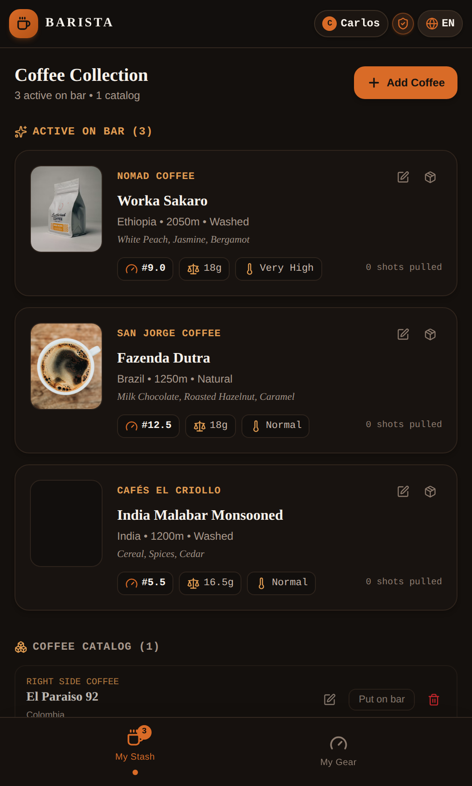
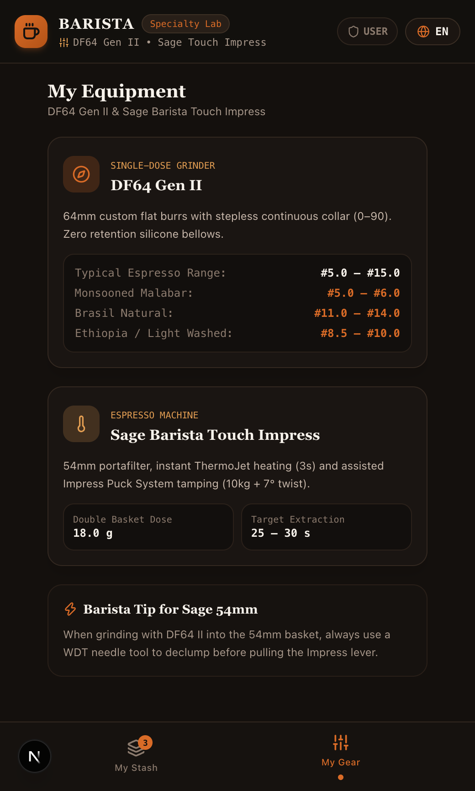
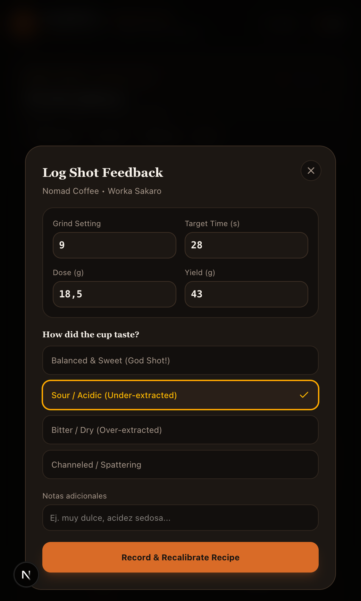
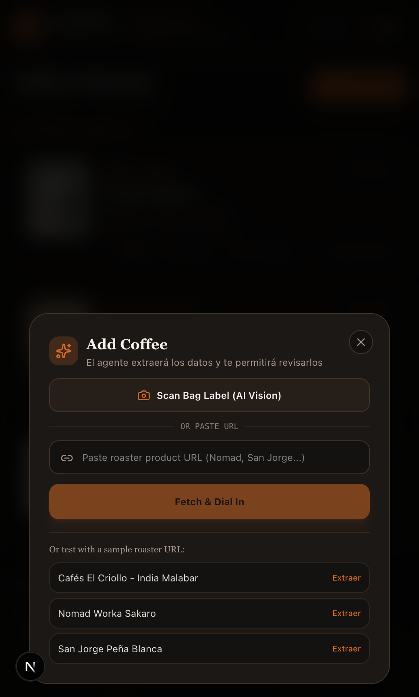

<div align="center">

# ☕ Barista

**The intelligent specialty coffee dial-in assistant & bean stash manager with adaptive extraction recalibration.**  
Engineered with a modular architecture to support any grinder and espresso machine setup, with out-of-the-box profiles for the **DF64 Gen II** and **Sage Barista Touch Impress**.

[](https://github.com/csp33/barista/actions/workflows/ci.yml)
[](https://nextjs.org/)
[](https://react.dev/)
[](https://www.typescriptlang.org/)
[](https://tailwindcss.com/)
[](https://vitest.dev/)
[](https://github.com/csp33/barista/pkgs/container/barista)
[](#license)

</div>

---

## 🎯 Overview

Dialing in specialty coffee at home is often frustrating: different roasters, bean densities, processing methods, and resting periods require constant recipe adjustments.

**Barista** removes the guesswork. It calculates optimal baseline extraction recipes for your exact bean specifications and adapts them over time based on your cup taste feedback. Built around a modular domain model, Barista decouples coffee physics from specific hardware, supporting custom grinder burr profiles, portafilter geometries (54mm / 58mm), and heating systems (with pre-configured reference profiles for the **DF64 Gen II** and **Sage Barista Touch Impress**).

---

## 📸 Screenshots

### 1. Dial-In Station & Technical Parameters
Real-time DF64 micrometer grind dial, Sage ThermoJet temperature preset, dose, yield, ratio, and recipe explanation rationale.

<div align="center">
  
</div>

---

### 2. Coffee Stash & Cellar Vault
Organize beans active on bar vs. resting or finished beans in your cellar history. Quick-glance dial-in metrics on every card.

<div align="center">
  
</div>

---

### 3. Equipment Specifications & Barista Workflow
Pre-calibrated profiles for DF64 Gen II and Sage Barista Touch Impress with 54mm basket headspace and WDT distribution guidance.

<div align="center">
  
</div>

---

### 4. Sensory Feedback & Dynamic Recalibration
Log shot time, yield, and cup sensory feedback (God shot, Sour, Bitter, Channeled) to automatically recalibrate grind setting and temperature.

<div align="center">
  
</div>

---

### 5. Smart Bean Ingestion (Scraper + AI Vision)
Import coffee specs in seconds by pasting any roaster URL or snapping a photo of the coffee bag label with AI OCR.

<div align="center">
  
</div>

---

## ✨ Features

- **🎛️ Intelligent Recipe Engine**:
  - Bean-density and roast-aware dose calculation (e.g. 18.5g for dense high-altitude beans, 16.5g for expanded Monsooned Malabar, 17.0g for dark roasts in 54mm baskets).
  - Target DF64 grind baseline calibrated to processing method (washed, natural, anaerobic honey) and altitude (MASL).
  - Sage ThermoJet temperature selection (`Low 90°C`, `Normal 93°C`, `High 95°C`, `Very High 96°C`).
  - Recommended rest window tracking after roast date.
- **🔄 Closed-Loop Recalibration**:
  - Taste a sour shot? One tap adjusts grind finer, elevates ThermoJet temperature, and stretches yield.
  - Channeling or spraying? Suggests coarsening grind and reminds manual WDT needle distribution.
- **📷 Roaster Web Scraper & AI Vision**:
  - Paste URLs from specialty roasters (Nomad, San Jorge, El Criollo, Right Side, etc.) to auto-populate origin, process, altitude, and tasting notes.
  - Scan coffee bag labels using OpenAI Vision OCR fallback.
- **🌐 Bilingual UI**:
  - Instant, client-side toggle between English and Spanish.
- **📱 Editorial Specialty Coffee UI**:
  - Earthy crema palettes, dark roast charcoal theme, and monospaced technical brew parameters. Fully mobile-responsive.

---

## ⚙️ Modular Equipment Support

Barista separates coffee physics and bean extraction profiles from specific hardware models. Equipment specifications (burr geometry, adjustment mechanisms, basket diameters, dose capacities, and temperature controls) are modeled as pluggable domain entities:

| Equipment Profile | Type | Key Parameters & Considerations |
| :--- | :--- | :--- |
| **DF64 Gen II** *(Reference)* | Single-Dose Grinder | 64mm custom flat burrs, stepless continuous collar (0–90 scale), plasma generator, single-dose bellows. Espresso baseline: **#5.0 to #15.0**. |
| **Sage Barista Touch Impress** *(Reference)* | Espresso Machine | 54mm portafilter basket, 3-second ThermoJet heating, assisted Impress puck system (10kg tamp with 7° twist). Compatible with WDT needle declumping. |
| *Custom / Future Setups* | Pluggable Domain | Decoupled domain entities supporting 58mm commercial baskets, lever machines, manual grinders, and custom PID temperatures. |

---

## 🏛️ Hexagonal Architecture

The codebase adheres strictly to **Ports and Adapters (Hexagonal Architecture)** enforced by automated Vitest architecture tests:

```text
src/
├── core/
│   ├── domain/               # Pure business rules & entities (Zero external dependencies)
│   │   ├── coffee/           # Coffee entity & value objects
│   │   ├── equipment/        # Grinder & EspressoMachine domain models
│   │   └── recipe/           # Recipe calculation, explainer & feedback calibration
│   └── application/          # Use cases & interfaces
│       ├── ports/in/         # Primary driver ports
│       ├── ports/out/        # Secondary driven ports (Repositories, Scrapers, AI)
│       └── usecases/         # Application orchestrators
└── adapters/
    ├── in/                   # UI components, React hooks, API route handlers
    │   ├── ui/               # Dashboard, DialInCard, Modals, i18n
    │   └── api/              # Next.js Route Handlers
    └── out/                  # External implementations
        ├── persistence/      # Coffee & Recipe repositories (In-memory / Prisma)
        ├── scraping/         # Roaster web scrapers & heuristic parsers
        ├── ai/               # OpenAI Sommelier & Vision scanner
        └── logger/           # Structured console logger
```

---

## 🚀 Getting Started

### Prerequisites

- Node.js 20+ or 22+
- npm 10+ (or Docker)

### Installation

1. **Clone repository:**
   ```bash
   git clone https://github.com/csp33/barista.git
   cd barista
   ```

2. **Install dependencies:**
   ```bash
   npm install
   ```

3. **Configure environment variables (optional):**
   ```bash
   cp .env.example .env.local # or create .env
   ```
   ```env
   # Optional: Required only for AI bag scanning and LLM web extraction
   OPENAI_API_KEY=sk-...
   ```

4. **Run development server:**
   ```bash
   npm run dev
   ```
   Open [http://localhost:3000](http://localhost:3000) with your browser.

---

## 🧪 Testing & Quality Assurance

```bash
# Run all unit tests
npm test

# Run hexagonal architecture boundary enforcement tests
npm run test:arch

# Run linter
npm run lint
```

---

## 🐳 Docker Deployment

You can run Barista via Docker or pull the prebuilt container image from GitHub Container Registry (GHCR):

```bash
# Pull and run directly from GHCR
docker run -d -p 3000:3000 --name barista ghcr.io/csp33/barista:latest

# Or build and run locally with Docker Compose
docker compose up -d --build
```

---

## 📄 License

This project is open-source and available under the [MIT License](LICENSE).
